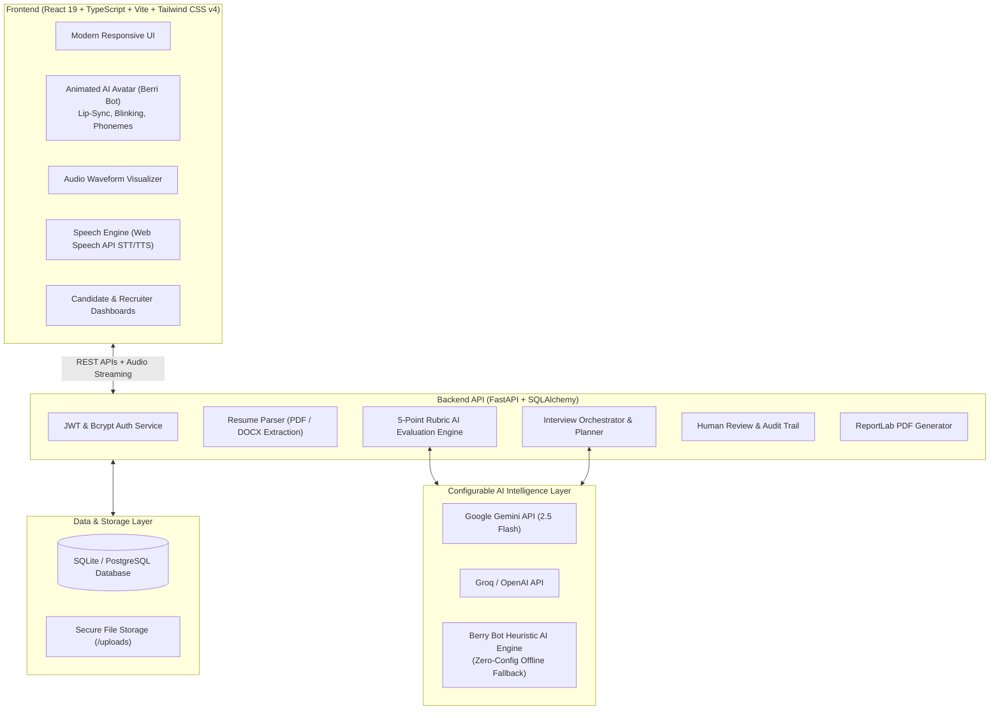
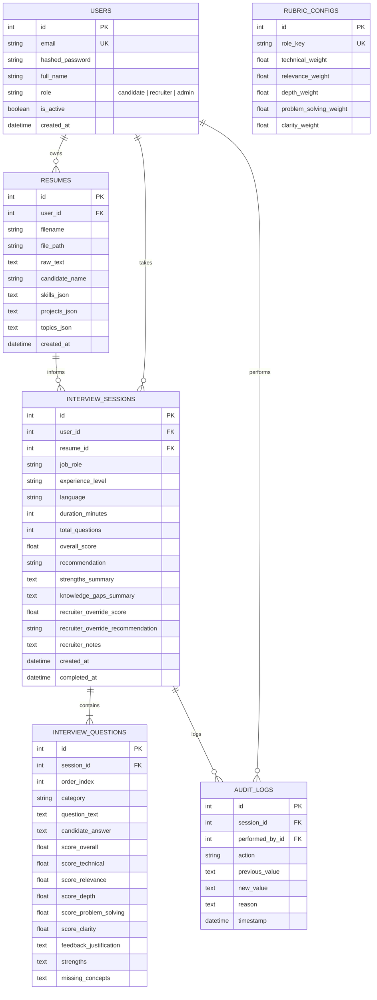

# Berri Bot: Intelligent, Multilingual, Resume-Based AI Interview Platform

[](https://www.python.org/)
[](https://fastapi.tiangolo.com/)
[](https://react.dev/)
[](https://www.typescriptlang.org/)
[](https://tailwindcss.com/)
[](https://opensource.org/licenses/MIT)

> **Inspired by HCL's Berri Bot:** An enterprise-ready, ethical AI interview platform featuring an animated avatar with real-time lip-sync, multilingual voice interaction (English, Telugu, Hindi, Tamil, Kannada), resume parsing without qualification hallucination, dynamic follow-up questioning, a transparent 5-point explainable rubric, recruiter human-in-the-loop audit logs, and downloadable PDF reports.

---

## 📑 Table of Contents
1. [System Architecture](#-system-architecture)
2. [Key Innovations & Features](#-key-innovations--features)
3. [Supported Languages](#-supported-languages)
4. [Scoring Rubric & Evaluation Engine](#-scoring-rubric--evaluation-engine)
5. [Database Schema & ERD](#-database-schema--erd)
6. [API Specifications](#-api-specifications)
7. [Project Structure](#-project-structure)
8. [Setup & Execution Guide](#-setup--execution-guide)
9. [Pre-Loaded Demo Accounts & Test Resumes](#-pre-loaded-demo-accounts--test-resumes)
10. [Testing & Verification](#-testing--verification)
11. [Deployment Guide](#-deployment-guide)
12. [Ethical AI & Fairness Compliance](#-ethical-ai--fairness-compliance)

---

## 🏛 System Architecture

The platform follows a clean decoupled client-server architecture:



---

## 🌟 Key Innovations & Features

### 1. Animated AI Interviewer Avatar (`Berri Bot`)
- **Real-Time Lip-Sync:** Multi-phoneme mouth aperture animations dynamically synchronize with spoken audio questions.
- **Natural Biological Behaviors:** Periodic eye blinking (every 3–5 seconds), eye gaze tracking, and head tilt reactions.
- **Attentive Emotional States:** Automatically transitions between **Greeting**, **Speaking**, **Listening** (when candidate speaks), and **Thinking** (during real-time rubric evaluation).
- **Sound Wave Visualizer:** Frequency equalizer responds directly to microphone and speech synthesis audio.
- **Live Captions:** Real-time subtitles displayed underneath avatar with replay question controls.

### 2. Intelligent Multilingual Communication
- Full support across **5 major Indian languages**:
  - **English** (`en-US` / `en-IN`)
  - **Telugu** (`te-IN` - తెలుగు)
  - **Hindi** (`hi-IN` - हिन्दी)
  - **Tamil** (`ta-IN` - தமிழ்)
  - **Kannada** (`kn-IN` - ಕನ್ನಡ)
- Preserves technical keywords, frameworks, and syntax (e.g. `React custom hooks`, `Spring Boot microservices`, `PostgreSQL composite indexes`) in bilingual form for natural tech-industry fluency.
- Dual input mode: Spoken voice answers via microphone with real-time transcript editing OR direct typed input fallback.

### 3. Grounded Resume Analysis (Zero Hallucination)
- Extracts candidate name, email, phone, education, skills, projects, and work experience from **PDF** and **DOCX** files.
- Generates questions specifically asking about the candidate's actual projects (e.g. architectural design, state management, concurrency hurdles, and database schema).
- **Review Before Interview:** Candidates inspect and can fine-tune extracted attributes before starting the session.
- Pre-loaded sample resumes for Full Stack, AI/ML, and Java backend candidates for immediate testing without needing a local resume file.

### 4. Dynamic Follow-Up Questioning
- The interview feels like a conversational dialogue rather than a static test.
- If a candidate mentions caching, authentication, or scale in their answer, Berri Bot dynamically pivots to ask deep follow-ups (e.g. cache invalidation strategies, CSRF protection, or horizontal database scaling).

### 5. Transparent 5-Point Explainable Rubric
Each answer is evaluated on a configurable, evidence-based rubric:

| Evaluation Criterion | Weight | Assessment Standard |
|---|---:|---|
| **Technical Correctness** | **30%** | Accuracy of programming principles, design patterns, and APIs |
| **Relevance to Question** | **20%** | Direct alignment with prompt requirements and constraints |
| **Depth of Understanding** | **20%** | Grasp of underlying architecture, concurrency, and memory |
| **Problem Solving** | **20%** | Systematic trade-off analysis, edge-case mitigation, and design |
| **Clarity of Explanation** | **10%** | Structured articulation without excessive verbosity |

### 6. Recruiter Portal & Human-in-the-Loop Audit
- Candidates are **never** rejected automatically by AI. The result serves as decision-support guidance.
- Recruiters can search and filter sessions, view full question transcripts, override scores with mandatory audit justification notes, and adjust rubric weights per job role.
- Comprehensive immutable audit trail (`AuditLog`) tracks who changed what and when.

### 7. Official PDF Performance Reports
- Downloads comprehensive, publication-grade PDF reports containing candidate details, radar score distribution, question-by-question evaluations, strengths, gaps, and personalized learning roadmaps.

---

## 🗄 Database Schema & ERD



---

## 🚀 Setup & Execution Guide

### Prerequisites
- **Python:** 3.11, 3.12, or 3.13 installed
- **Node.js:** v18, v20, v22, or v24 installed
- **npm:** v9+ installed

---

### Step 1: Clone the Codebase
```bash
cd "e:/Berry Bot"
```

---

### Step 2: Backend Setup & Run

1. Navigate to the `backend/` directory:
   ```bash
   cd backend
   ```

2. Activate the virtual environment (created in `backend/venv`):
   - **Windows PowerShell:**
     ```powershell
     .\venv\Scripts\Activate.ps1
     ```
   - **Windows Command Prompt:**
     ```cmd
     venv\Scripts\activate.bat
     ```
   - **Linux / macOS:**
     ```bash
     source venv/bin/activate
     ```

3. (Optional) Install dependencies if running on a new machine:
   ```bash
   pip install -r requirements.txt
   ```

4. Environment Configuration:
   - Check `backend/.env` (default settings use SQLite and the built-in Heuristic AI Engine).
   - If you wish to use Google Gemini, add your API key:
     ```env
     GEMINI_API_KEY="your-gemini-api-key-here"
     ```

5. Run the Backend API Server:
   ```bash
   python run.py
   ```
   *The server runs on **http://127.0.0.1:8000** with interactive Swagger API docs at **http://127.0.0.1:8000/docs**.*

---

### Step 3: Frontend Setup & Run

1. Open a new terminal and navigate to `frontend/`:
   ```bash
   cd "e:/Berry Bot/frontend"
   ```

2. (Optional) Install npm packages if on a new machine:
   ```bash
   npm install
   ```

3. Start the Vite React development server:
   ```bash
   npm run dev
   ```
   *The application will be live at **http://localhost:5173**.*

---

## 🔑 Pre-Loaded Demo Accounts & Test Resumes

For effortless grading and viva project demonstration, the database is auto-seeded with test credentials and resumes:

| Role | Email | Password | Description |
|---|---|---|---|
| **Candidate** | `candidate@example.com` | `password123` | Priya Sharma (Full Stack Developer) with completed sample interview and report |
| **Recruiter** | `recruiter@example.com` | `password123` | Alex Morgan (Talent Operations) with candidate reviews and override rights |
| **System Admin** | `admin@example.com` | `admin123` | Administrator with full rubric and audit permissions |

> **Tip:** You can click the **"Demo Candidate"** or **"Demo Recruiter"** button on the Navbar or Login Page to sign in instantly with one click.

### Built-in Test Resumes Available:
1. **Full Stack Developer (Priya Sharma):** React, TypeScript, Node.js, PostgreSQL, Redis pub/sub, Docker.
2. **AI/ML Engineer (Rahul Varma):** PyTorch, DenseNet-121, Hugging Face RAG, FastAPI, Milvus Vector DB.
3. **Java Enterprise Developer (Ananya Reddy):** Java 17, Spring Boot, Apache Kafka, MySQL, Redis Redlock.

---

## 🧪 Testing & Verification

Run the comprehensive automated pytest test suite in the backend:
```bash
cd backend
venv\Scripts\pytest -v
```

### Verified Test Matrix:
- `tests/test_auth.py`: Password hashing with bcrypt, JWT token issuance and expiration validation.
- `tests/test_resume_parser.py`: PDF/DOCX contact regex, skill taxonomy chunking, and project extraction.
- `tests/test_evaluation.py`: 5-point rubric weighting, semantic technical scoring, and dynamic follow-up triggers.
- `tests/test_interview_flow.py`: End-to-end integration test from login to session creation, answer submission, and evaluation.

To build and verify the frontend:
```bash
cd frontend
npm run build
```

---

## 🌐 API Specifications

| Method | Endpoint | Description |
|---|---|---|
| `GET` | `/api/health` | System health, active AI provider, supported languages |
| `POST` | `/api/auth/register` | Register a new candidate or recruiter account |
| `POST` | `/api/auth/login` | Login and receive JWT access token |
| `GET` | `/api/auth/me` | Retrieve profile of authenticated user |
| `POST` | `/api/resumes/upload` | Upload & parse PDF/DOCX resume |
| `GET` | `/api/resumes/sample/{key}` | Instant preloaded sample resume |
| `GET` | `/api/resumes/{id}` | Retrieve parsed structured resume details |
| `PUT` | `/api/resumes/{id}` | Update candidate details or parsed skills |
| `DELETE`| `/api/resumes/{id}` | Purge resume file and database record |
| `POST` | `/api/interviews` | Create personalized interview session rooted in resume |
| `GET` | `/api/interviews/history` | List previous interview sessions for candidate |
| `GET` | `/api/interviews/{id}` | Get current interview status and active question |
| `POST` | `/api/interviews/{id}/start`| Start interview session countdown |
| `POST` | `/api/interviews/{id}/answer`| Submit spoken/typed answer and get rubric evaluation |
| `POST` | `/api/interviews/{id}/next-question` | Advance to next question or finalize session |
| `POST` | `/api/interviews/{id}/pause`| Pause live interview session |
| `POST` | `/api/interviews/{id}/resume`| Resume paused interview session |
| `POST` | `/api/interviews/{id}/end` | Conclude interview early and aggregate scores |
| `GET` | `/api/interviews/{id}/report`| Full comprehensive performance report with radar analytics |
| `GET` | `/api/interviews/{id}/report/pdf` | Download official PDF report via ReportLab |
| `GET` | `/api/recruiter/candidates` | List candidate sessions with search and filters |
| `POST` | `/api/recruiter/sessions/{id}/override` | Recruiter score override with audit trail |
| `GET` | `/api/recruiter/rubrics` | Retrieve rubric weights configuration |
| `PUT` | `/api/recruiter/rubrics` | Update rubric percentage weights |
| `GET` | `/api/recruiter/audit-logs` | Retrieve immutable audit trail |

---

## 🚢 Deployment Guide

### Frontend Deployment (Vercel / Netlify)
1. Push `frontend/` directory to GitHub.
2. In Vercel, set Root Directory to `frontend`.
3. Set Build Command: `npm run build`
4. Set Output Directory: `dist`
5. Configure environment variable `VITE_API_BASE_URL` pointing to the deployed backend URL.

### Backend Deployment (Render / Railway / Docker)
1. Deploy `backend/` directory using Python runtime or Dockerfile:
   ```dockerfile
   FROM python:3.11-slim
   WORKDIR /app
   COPY requirements.txt .
   RUN pip install --no-cache-dir -r requirements.txt
   COPY . .
   EXPOSE 8000
   CMD ["uvicorn", "app.main:app", "--host", "0.0.0.0", "--port", "8000"]
   ```
2. Configure environment variables (`SECRET_KEY`, `DATABASE_URL`, and optional `GEMINI_API_KEY`).

---

## 🛡 Ethical AI & Fairness Compliance

- **No Accent or Dialect Bias:** Answers are parsed for semantic understanding of engineering concepts. Candidates are never penalized for pronunciation nuances or regional language dialects.
- **Decision-Support Designation:** Berri Bot outputs recommendations ("Strong Match", "Potential Match", "Further Assessment Recommended", "Does Not Yet Meet Defined Criteria"). It explicitly does not make automated employment terminations or final hiring denials.
- **Auditability:** Every score adjustment, question prompt, and rubric weighting is permanently recorded in the audit logs for compliance review.
- **Privacy First:** Raw audio streams are processed purely in real-time in the browser and are never saved or sold. Candidates can purge their uploaded resumes and interview data at any time from the Settings page.

---

*Developed for Academic Project Demonstrations, Research Showcases, and Enterprise AI Recruitment Innovation.*
# BerryBot
